

  
  
  

<a href="https://aleixaj.com"><picture><source media="(max-width: 620px)" srcset="assets/ca/narrow/header.svg"></picture></a>

  
  
  

### Sobre mi

Desenvolupador de programari full-stack amb més de 5 anys d'experiència professional. La meva base són **PHP i
JavaScript**, però no m'hi limito: treballo habitualment amb **TypeScript, React, Next.js, Laravel, Node.js i
SQL**, i he publicat projectes amb **SvelteKit, Electron, Supabase i Godot**.

En l'àmbit professional he desenvolupat solucions a mida per a distribuïdores d'electricitat i gas, a més
d'aplicacions internes full-stack. També he gestionat releases i desplegaments per a clients com Nestlé,
CaixaBank o Naturgy. Avui porto els meus propis productes **de la idea a producció**: una botiga full-stack, un
joc publicat a Google Play, un assistent d'IA per a Windows i diverses apps web desplegades.

M'importa el que no es veu en una demo: la seguretat, el rendiment mesurat, els tests i que el producte aguanti
en mans d'usuaris reals.

 

## Projectes destacats

  <a href="https://github.com/AleixAj/obsidian">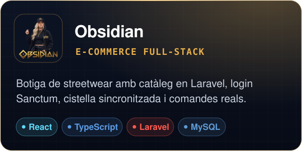</a>
  <a href="https://obsidian.aleixaj.com"><picture><source media="(max-width: 1279px)" srcset="assets/ca/cards/obsidian-demo.svg">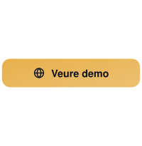</picture></a> <a href="https://github.com/AleixAj/obsidian"><picture><source media="(max-width: 1279px)" srcset="assets/ca/cards/obsidian-code.svg">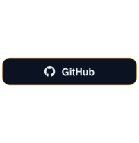</picture></a>

  <a href="https://github.com/AleixAj/orbex-web">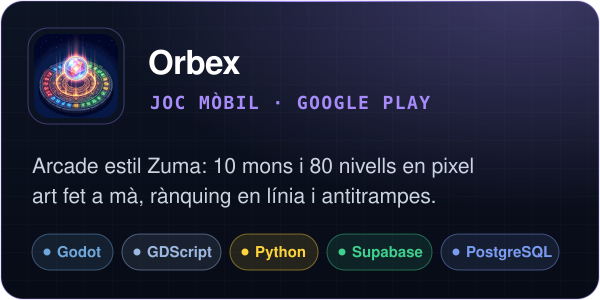</a>
  <a href="https://play.google.com/store/apps/details?id=com.aleix.orbex"><picture><source media="(max-width: 1279px)" srcset="assets/ca/cards/orbex-play.svg">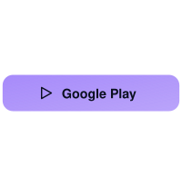</picture></a> <a href="https://kylen02.itch.io/orbex"><picture><source media="(max-width: 1279px)" srcset="assets/ca/cards/orbex-game.svg">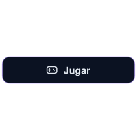</picture></a>

  <a href="https://github.com/AleixAj/nexus">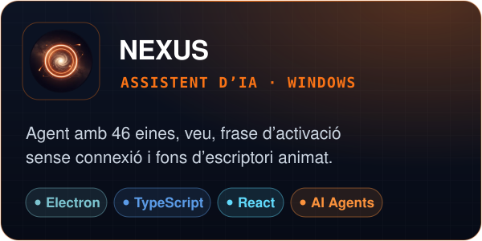</a>
  <a href="https://github.com/AleixAj/nexus/releases/latest/download/NEXUS-Setup.exe"><picture><source media="(max-width: 1279px)" srcset="assets/ca/cards/nexus-download.svg">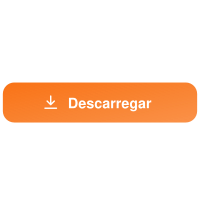</picture></a> <a href="https://github.com/AleixAj/nexus"><picture><source media="(max-width: 1279px)" srcset="assets/ca/cards/nexus-code.svg">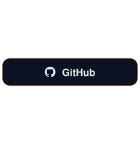</picture></a>

  <a href="https://github.com/AleixAj/waymark">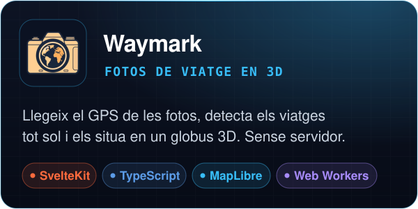</a>
  <a href="https://waymark.aleixaj.com"><picture><source media="(max-width: 1279px)" srcset="assets/ca/cards/waymark-demo.svg">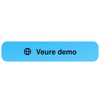</picture></a> <a href="https://github.com/AleixAj/waymark"><picture><source media="(max-width: 1279px)" srcset="assets/ca/cards/waymark-code.svg">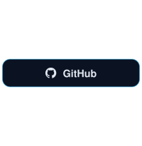</picture></a>

  <a href="https://github.com/AleixAj/nadir">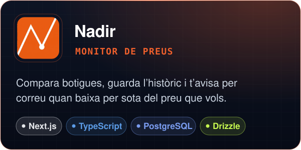</a>
  <a href="https://nadir.aleixaj.com"><picture><source media="(max-width: 1279px)" srcset="assets/ca/cards/nadir-demo.svg">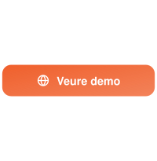</picture></a> <a href="https://github.com/AleixAj/nadir"><picture><source media="(max-width: 1279px)" srcset="assets/ca/cards/nadir-code.svg">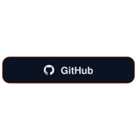</picture></a>

  <a href="https://github.com/AleixAj/kylenchat">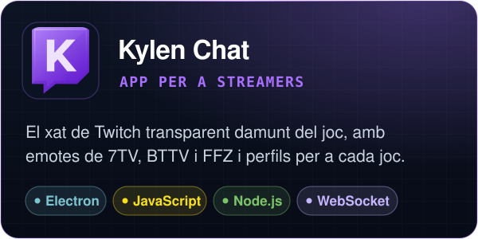</a>
  <a href="https://github.com/AleixAj/kylenchat/releases/latest/download/KylenChat-Setup.exe"><picture><source media="(max-width: 1279px)" srcset="assets/ca/cards/kylenchat-download.svg">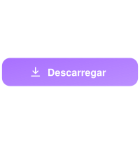</picture></a> <a href="https://github.com/AleixAj/kylenchat"><picture><source media="(max-width: 1279px)" srcset="assets/ca/cards/kylenchat-code.svg">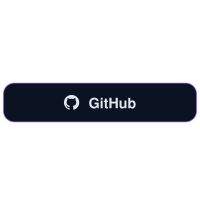</picture></a>

Més projectes, amb captures i detalls tècnics, a <a href="https://aleixaj.com"><b>aleixaj.com</b></a>

  <picture>
    <source media="(max-width: 620px)" srcset="assets/ca/narrow/stack.svg">
    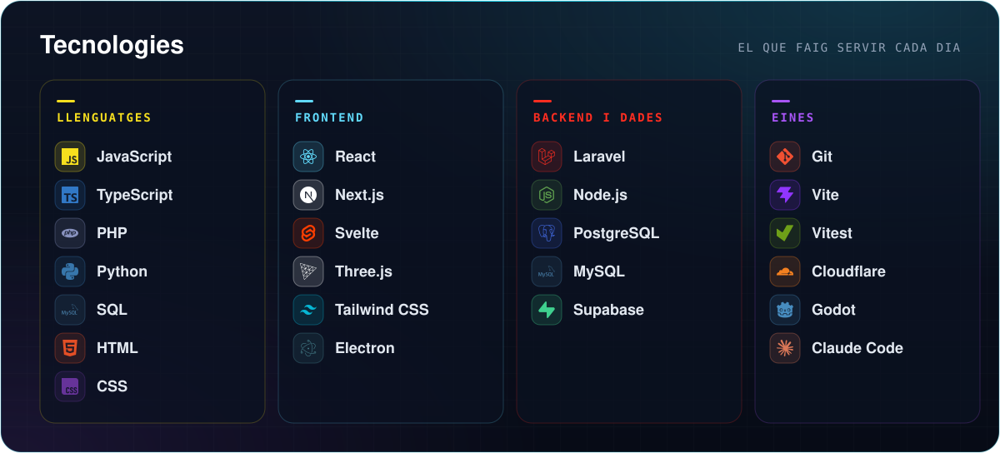
  </picture> 
  <picture>
    <source media="(max-width: 620px)" srcset="assets/ca/narrow/career.svg">
    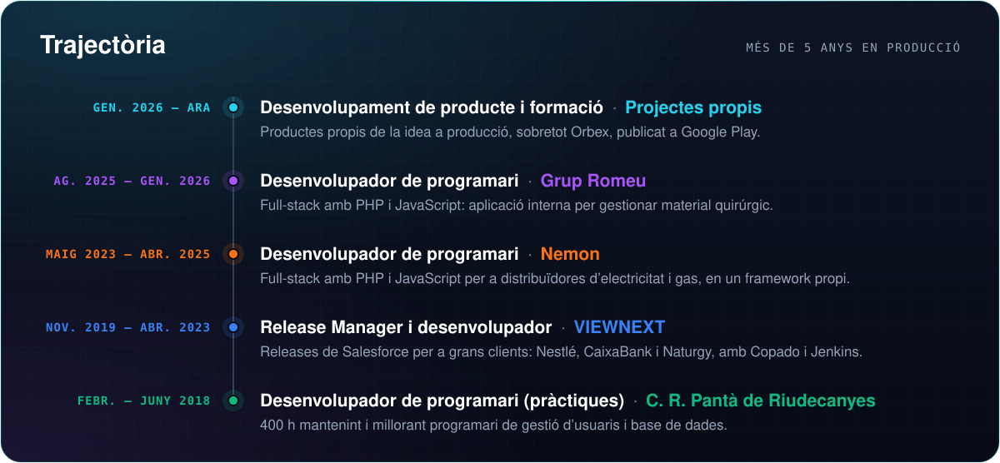
  </picture> 
  <picture>
    <source media="(max-width: 620px)" srcset="assets/ca/narrow/education.svg">
    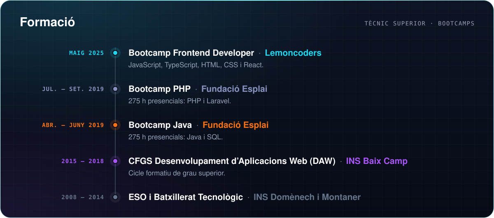
  </picture>

<b>Parlem?</b>

  
  
  

