

  
  
  

<a href="https://aleixaj.com"><picture><source media="(max-width: 620px)" srcset="assets/en/narrow/header.svg"></picture></a>

  
  
  

### About me

Full-stack software developer with 5+ years of professional experience. My core is **PHP and JavaScript**, but
I'm not limited to them: I regularly work with **TypeScript, React, Next.js, Laravel, Node.js and SQL**, and
I've shipped projects with **SvelteKit, Electron, Supabase and Godot**.

Professionally, I've built custom solutions for electricity and gas distributors, as well as full-stack internal
apps. I've also managed Salesforce releases and deployments for clients such as Nestlé, CaixaBank and Naturgy.
Today I take my own products **from idea to production**: a full-stack store, a game published on Google Play,
an AI assistant for Windows and several deployed web apps.

I care about what a demo doesn't show: security, measured performance, tests and a product that holds up in the
hands of real users.

 

## Featured projects

  <a href="https://github.com/AleixAj/obsidian">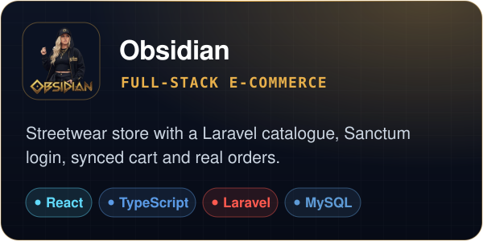</a>
  <a href="https://obsidian.aleixaj.com"><picture><source media="(max-width: 1279px)" srcset="assets/en/cards/obsidian-demo.svg">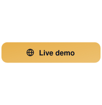</picture></a> <a href="https://github.com/AleixAj/obsidian"><picture><source media="(max-width: 1279px)" srcset="assets/en/cards/obsidian-code.svg">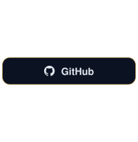</picture></a>

  <a href="https://github.com/AleixAj/orbex-web">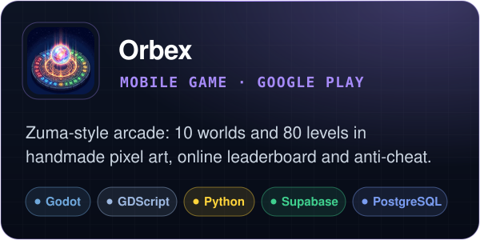</a>
  <a href="https://play.google.com/store/apps/details?id=com.aleix.orbex"><picture><source media="(max-width: 1279px)" srcset="assets/en/cards/orbex-play.svg">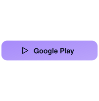</picture></a> <a href="https://kylen02.itch.io/orbex"><picture><source media="(max-width: 1279px)" srcset="assets/en/cards/orbex-game.svg">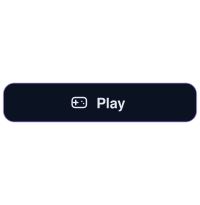</picture></a>

  <a href="https://github.com/AleixAj/nexus">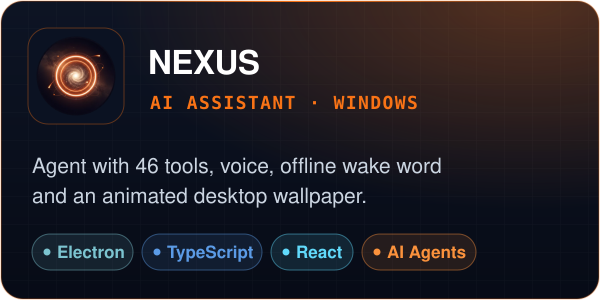</a>
  <a href="https://github.com/AleixAj/nexus/releases/latest/download/NEXUS-Setup.exe"><picture><source media="(max-width: 1279px)" srcset="assets/en/cards/nexus-download.svg"></picture></a> <a href="https://github.com/AleixAj/nexus"><picture><source media="(max-width: 1279px)" srcset="assets/en/cards/nexus-code.svg">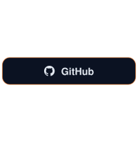</picture></a>

  <a href="https://github.com/AleixAj/waymark">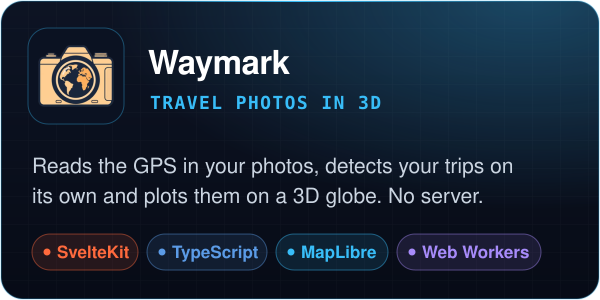</a>
  <a href="https://waymark.aleixaj.com"><picture><source media="(max-width: 1279px)" srcset="assets/en/cards/waymark-demo.svg">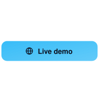</picture></a> <a href="https://github.com/AleixAj/waymark"><picture><source media="(max-width: 1279px)" srcset="assets/en/cards/waymark-code.svg">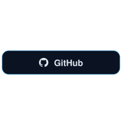</picture></a>

  <a href="https://github.com/AleixAj/nadir">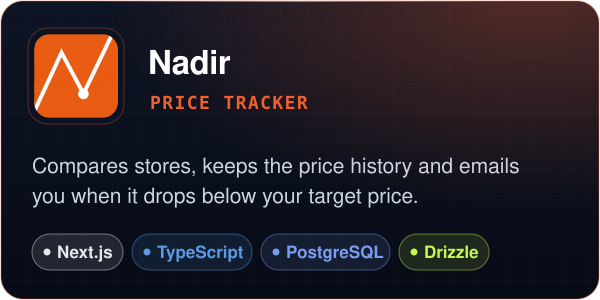</a>
  <a href="https://nadir.aleixaj.com"><picture><source media="(max-width: 1279px)" srcset="assets/en/cards/nadir-demo.svg"></picture></a> <a href="https://github.com/AleixAj/nadir"><picture><source media="(max-width: 1279px)" srcset="assets/en/cards/nadir-code.svg">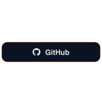</picture></a>

  <a href="https://github.com/AleixAj/kylenchat">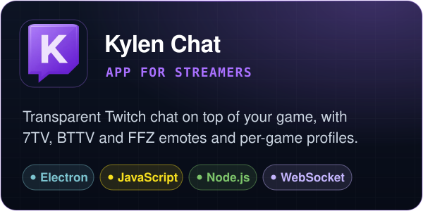</a>
  <a href="https://github.com/AleixAj/kylenchat/releases/latest/download/KylenChat-Setup.exe"><picture><source media="(max-width: 1279px)" srcset="assets/en/cards/kylenchat-download.svg">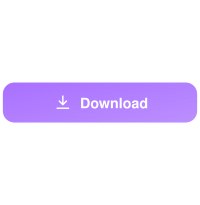</picture></a> <a href="https://github.com/AleixAj/kylenchat"><picture><source media="(max-width: 1279px)" srcset="assets/en/cards/kylenchat-code.svg">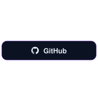</picture></a>

More projects, with screenshots and technical details, at <a href="https://aleixaj.com"><b>aleixaj.com</b></a>

  <picture>
    <source media="(max-width: 620px)" srcset="assets/en/narrow/stack.svg">
    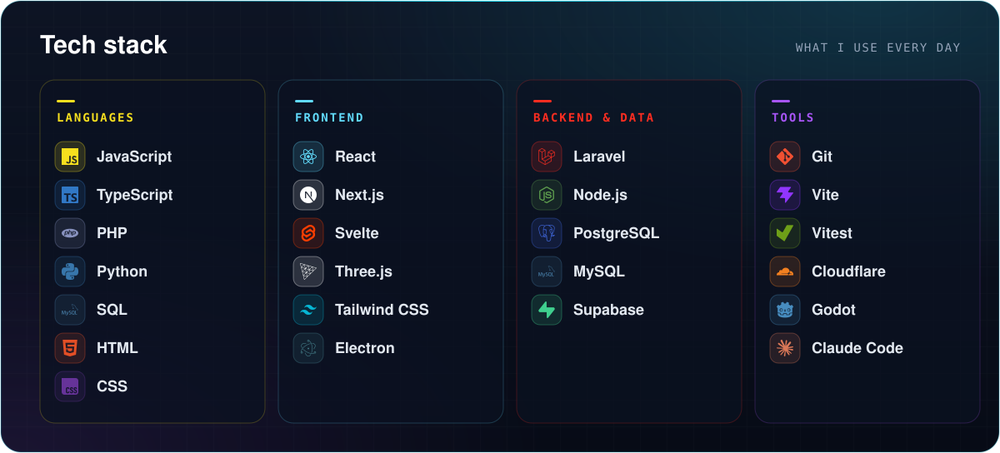
  </picture> 
  <picture>
    <source media="(max-width: 620px)" srcset="assets/en/narrow/career.svg">
    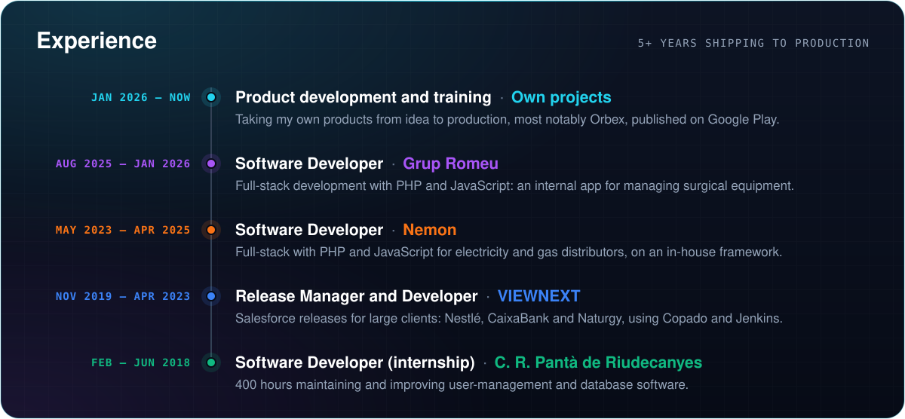
  </picture> 
  <picture>
    <source media="(max-width: 620px)" srcset="assets/en/narrow/education.svg">
    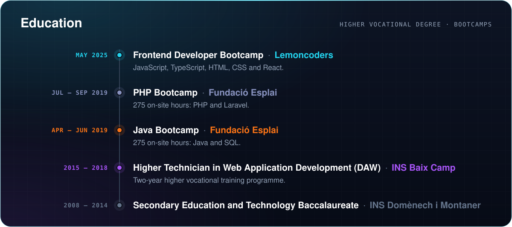
  </picture>

<b>Let’s talk</b>

  
  
  

