

  
  
  

<a href="https://aleixaj.com"><picture><source media="(max-width: 620px)" srcset="assets/narrow/header.svg"></picture></a>

  
  
  

### Sobre mí

Desarrollador de software full-stack con más de 5 años de experiencia profesional. Mi base son **PHP y
JavaScript**, pero no me limito a ellos: trabajo habitualmente con **TypeScript, React, Next.js, Laravel,
Node.js y SQL**, y he publicado proyectos con **SvelteKit, Electron, Supabase y Godot**.

En el ámbito profesional he desarrollado soluciones a medida para distribuidoras de electricidad y gas, además
de aplicaciones internas full-stack. También he gestionado releases y despliegues de Salesforce para clientes
como Nestlé, CaixaBank o Naturgy. Hoy llevo mis propios productos **de la idea a producción**: una tienda
full-stack, un juego publicado en Google Play, un asistente de IA para Windows y varias apps web desplegadas.

Me importa lo que no se ve en una demo: la seguridad, el rendimiento medido, los tests y que el producto aguante
en manos de usuarios reales.

 

## Proyectos destacados

  <a href="https://github.com/AleixAj/obsidian">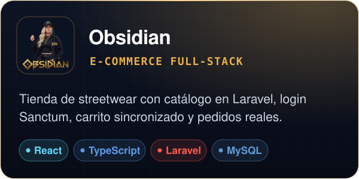</a>
  <a href="https://obsidian.aleixaj.com"><picture><source media="(max-width: 1279px)" srcset="assets/cards/obsidian-demo.svg">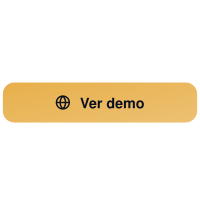</picture></a> <a href="https://github.com/AleixAj/obsidian"><picture><source media="(max-width: 1279px)" srcset="assets/cards/obsidian-code.svg">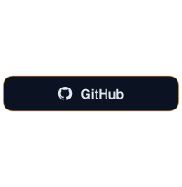</picture></a>

  <a href="https://github.com/AleixAj/orbex-web">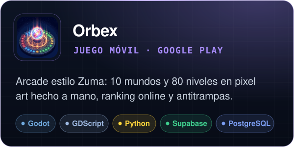</a>
  <a href="https://play.google.com/store/apps/details?id=com.aleix.orbex"><picture><source media="(max-width: 1279px)" srcset="assets/cards/orbex-play.svg">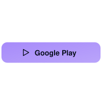</picture></a> <a href="https://kylen02.itch.io/orbex"><picture><source media="(max-width: 1279px)" srcset="assets/cards/orbex-game.svg">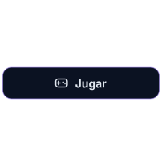</picture></a>

  <a href="https://github.com/AleixAj/nexus">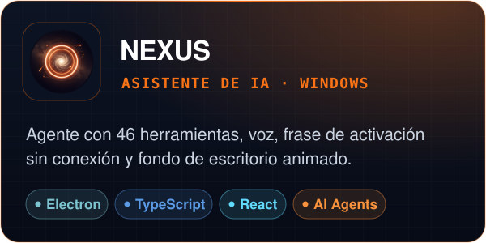</a>
  <a href="https://github.com/AleixAj/nexus/releases/latest/download/NEXUS-Setup.exe"><picture><source media="(max-width: 1279px)" srcset="assets/cards/nexus-download.svg">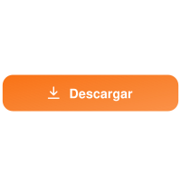</picture></a> <a href="https://github.com/AleixAj/nexus"><picture><source media="(max-width: 1279px)" srcset="assets/cards/nexus-code.svg">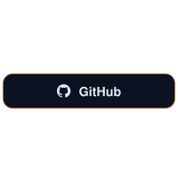</picture></a>

  <a href="https://github.com/AleixAj/waymark">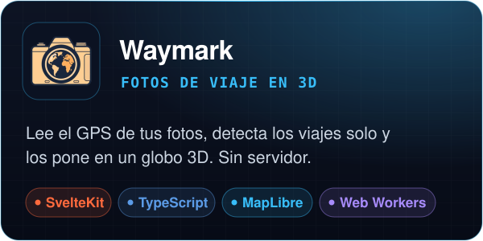</a>
  <a href="https://waymark.aleixaj.com"><picture><source media="(max-width: 1279px)" srcset="assets/cards/waymark-demo.svg">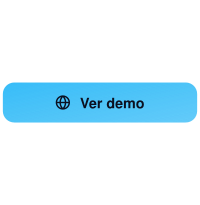</picture></a> <a href="https://github.com/AleixAj/waymark"><picture><source media="(max-width: 1279px)" srcset="assets/cards/waymark-code.svg">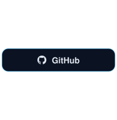</picture></a>

  <a href="https://github.com/AleixAj/nadir">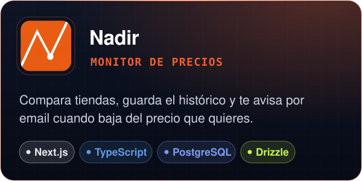</a>
  <a href="https://nadir.aleixaj.com"><picture><source media="(max-width: 1279px)" srcset="assets/cards/nadir-demo.svg">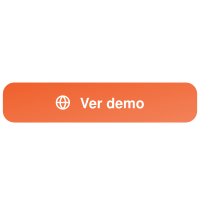</picture></a> <a href="https://github.com/AleixAj/nadir"><picture><source media="(max-width: 1279px)" srcset="assets/cards/nadir-code.svg">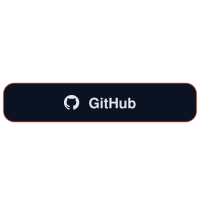</picture></a>

  <a href="https://github.com/AleixAj/kylenchat">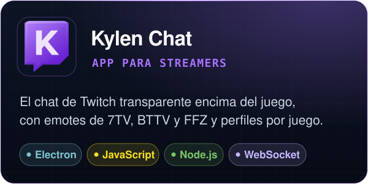</a>
  <a href="https://github.com/AleixAj/kylenchat/releases/latest/download/KylenChat-Setup.exe"><picture><source media="(max-width: 1279px)" srcset="assets/cards/kylenchat-download.svg">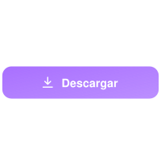</picture></a> <a href="https://github.com/AleixAj/kylenchat"><picture><source media="(max-width: 1279px)" srcset="assets/cards/kylenchat-code.svg">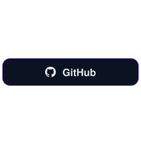</picture></a>

Más proyectos, con capturas y detalles técnicos, en <a href="https://aleixaj.com"><b>aleixaj.com</b></a>

  <picture>
    <source media="(max-width: 620px)" srcset="assets/narrow/stack.svg">
    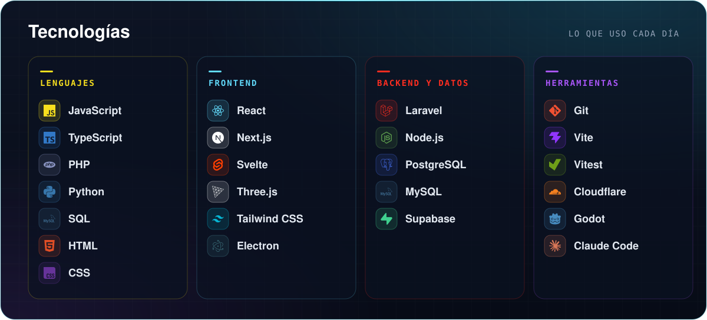
  </picture> 
  <picture>
    <source media="(max-width: 620px)" srcset="assets/narrow/career.svg">
    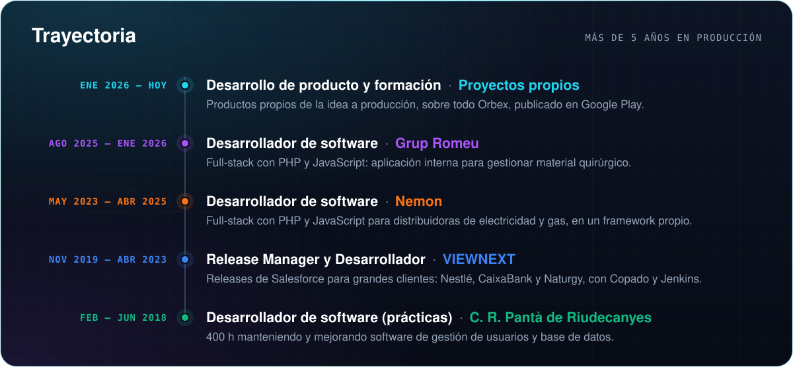
  </picture> 
  <picture>
    <source media="(max-width: 620px)" srcset="assets/narrow/education.svg">
    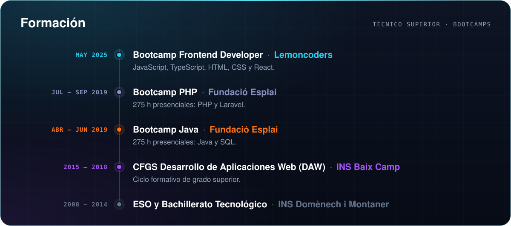
  </picture>

<b>¿Hablamos?</b>

  
  
  

